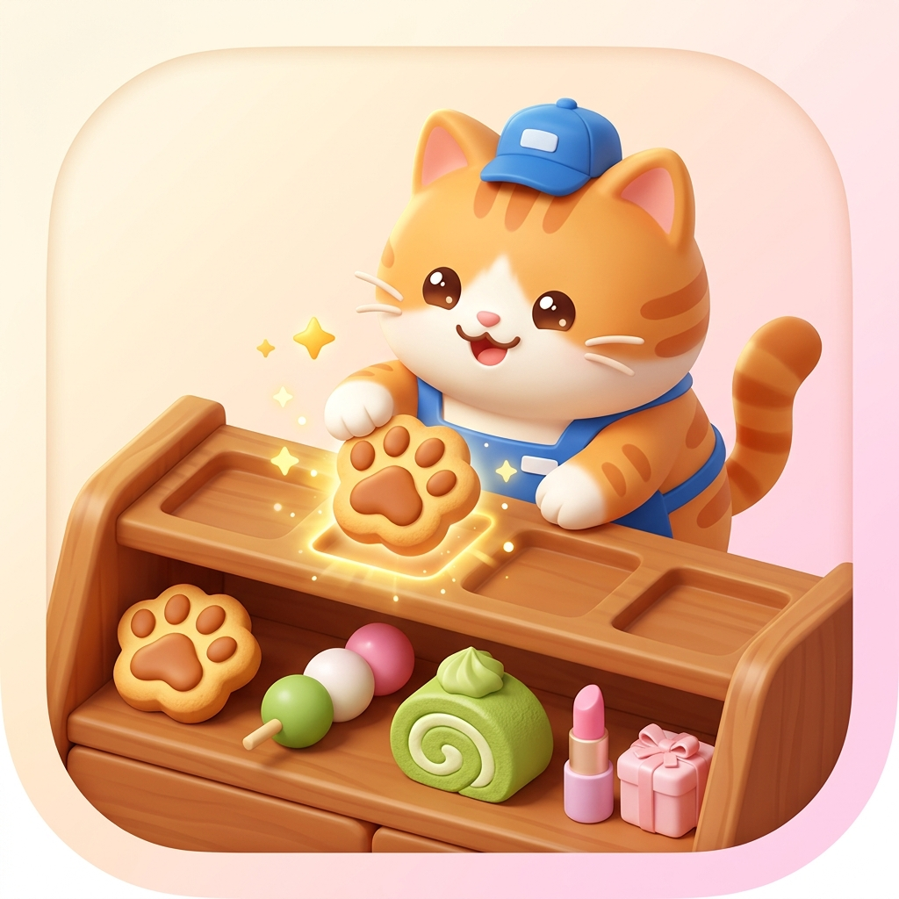
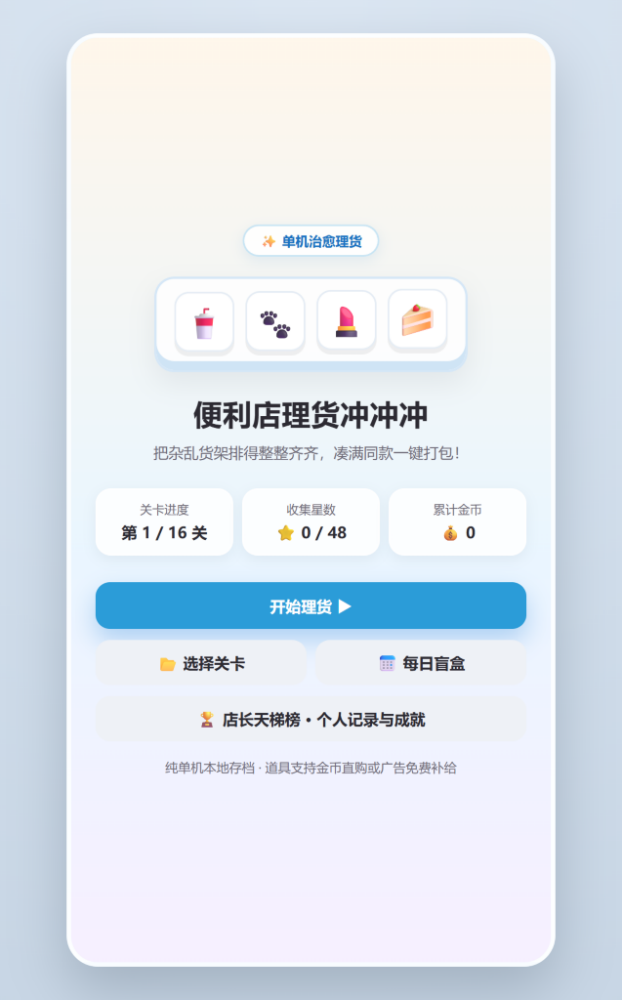
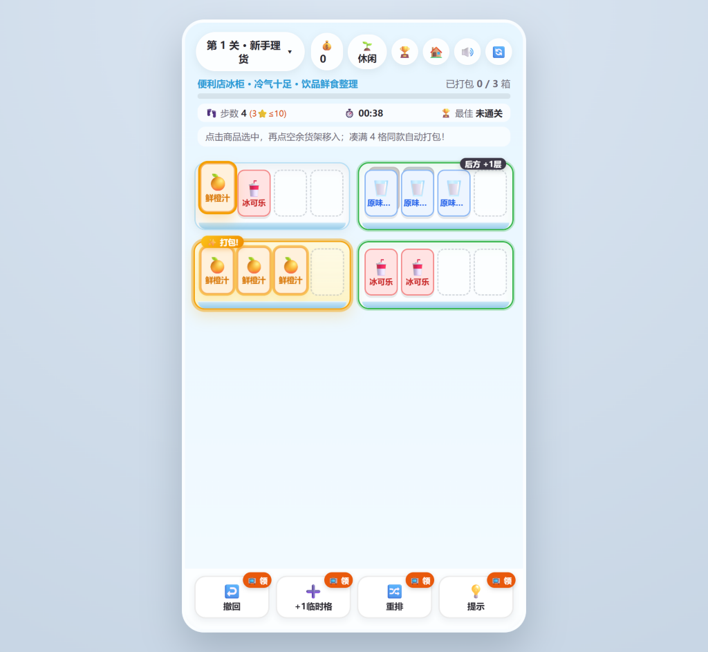
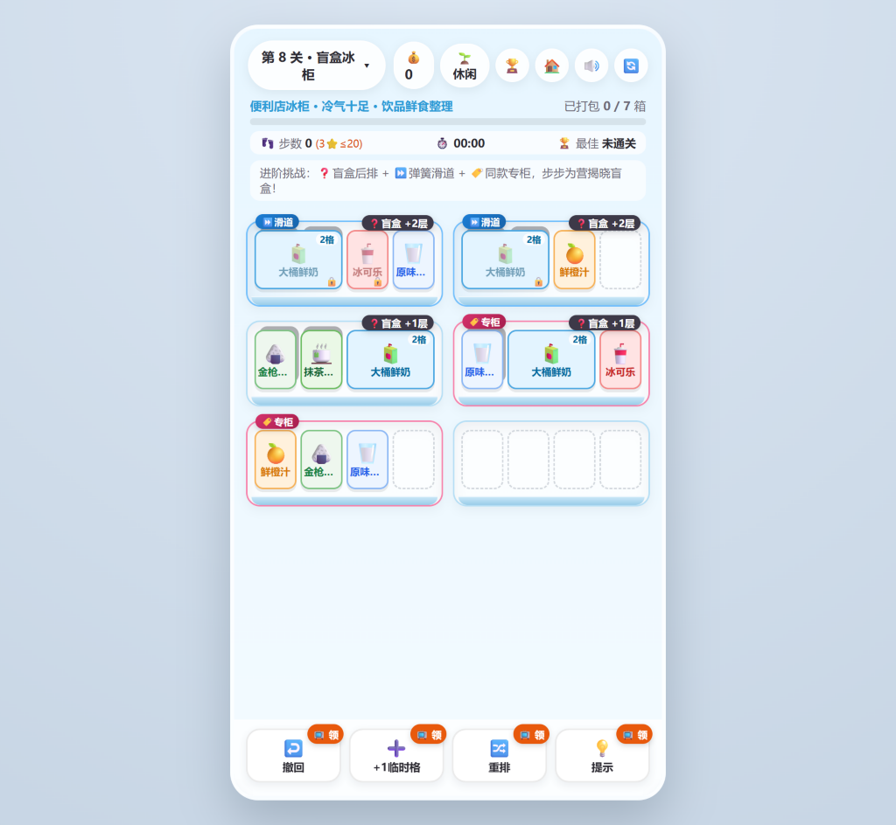
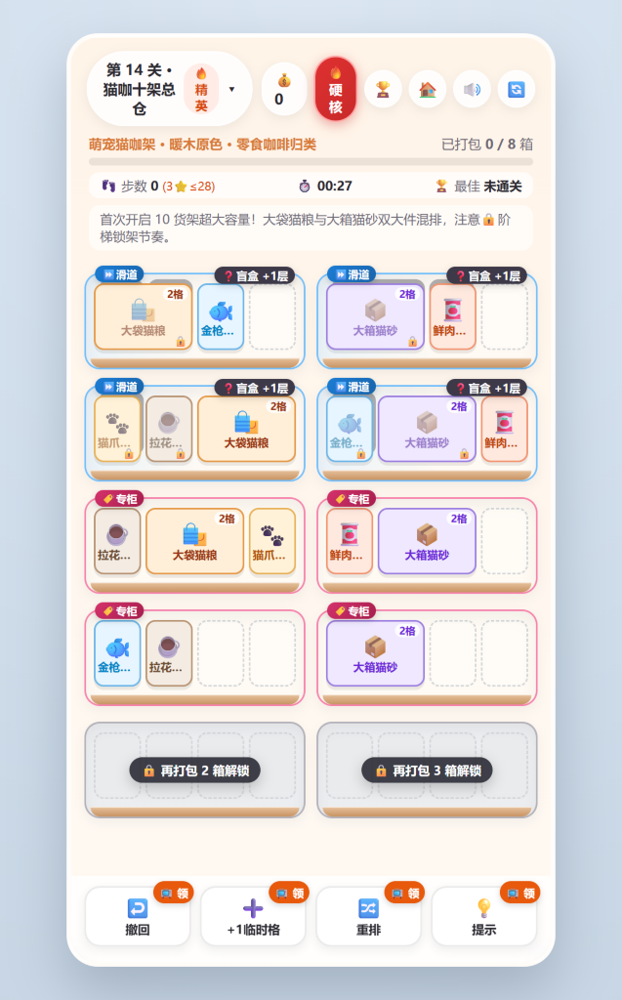

<p align="center">
  
</p>

<h1 align="center">Cozy Shelf Sort — 便利店理货冲冲冲</h1>

<p align="center">
  A zero-dependency, offline-first <strong>2D multi-layered shelf sorting &amp; packing puzzle game</strong> built with vanilla HTML5, CSS3, and JavaScript.
</p>

<p align="center">
  
  
  
  
  
</p>

<p align="center">
  <a href="README.md">中文</a> | <strong>English</strong>
</p>

---

## Overview

Move and group items across multi-depth shelves: matching **4 slots of identical items** on a front row automatically packs and clears the box with punchy audio-visual shockwaves, pulling shadowed back-row items forward. Juggle 1-slot standard goods and **2-slot wide items**, uncover **Mystery Back Rows**, break **Sealed Shelf Locks**, master **LIFO Chute & Strict Shelves**, unleash **Fever Magnet Bursts**, and climb the **Store Manager Ladder** across **16 single-player levels (4 to 10 shelves)**.

## Gameplay Screenshots

| Start Screen & Career Stats | Match Highlight & Pack Preview (Level 1) |
| :---: | :---: |
|  |  |
| **Chute + Strict + Mystery Shelves (Level 8)** | **10-Shelf Mega Stage & Hardcore Mode (Level 14)** |
|  |  |

## Key Features

- **High-Impact Frisson Hooks**:
  - **Punchy Instant Pack Feedback**: Every 4-slot pack triggers a synthesized bass thump, ascending chord arpeggio, shockwave ring, and 12-particle burst with zero flow interruption.
  - **Rush Order Bounties**: Dynamic 4-move delivery orders award **`+25`** bonus coins when the requested item is packed in time.
  - **3-Combo Fever Magnet Burst**: Reaching a `×3` Fever streak charges a one-tap Magnet that pulls and clears an entire matching pack across all shelves in **0 moves**.
- **Batch Chain Moves & Instant Auto-Complete**: Moving an item into a matching shelf (or double-clicking an item) automatically pulls sibling items along; revealing all hidden back rows unlocks a one-tap **Auto-Complete** button.
- **Water-Sort-Style Strategic Constraints (LIFO Chute Shelves + Strict Same-Item Shelves)**:
  - **LIFO Chute Shelves**: Only the outermost (rightmost) item can be picked; inner items are blocked until outer items are cleared.
  - **Strict Same-Item Shelves**: Only accepts items matching the shelf's rightmost item (or an empty shelf), preventing mixed-item dumping.
  - **Global Hardcore Mode Toggle**: Switch between Casual and Hardcore in the top HUD at any time to enforce LIFO Chute + Strict rules (all 16 levels are verified 100% solvable without boosters via `solveLevel`).
- **2-Slot Wide Items, Mystery Rows & Locked Shelves**: Combines 1-slot and 2-slot items with hidden back rows (`mysteryBack`) and pack-gated shelf locks (`lockedShelves`).
- **4 Cozy Themes · 16 Single-Player Levels (4–10 Shelves) · Daily Seed Challenge**: Features *Convenience Store Fridge*, *Cat Cafe Shelf*, *Healing Vanity*, and *Sweet Bakery* themes scaling from 4 shelves up to **8-shelf and 10-shelf mega stages**, plus a deterministic **Daily Mystery Challenge** (`FNV-1a` + `LCG` PRNG).
- **In-Game Coin Economy & Expandable Temp Tray**: Earn coins to expand the temporary tray (`+1` to `+4` slots) or buy Undo, Expand, Shuffle, and Smart Hint boosters.
- **Personal Best (PB) Records, Manager Ladder & Achievements**: Tracks best moves, fastest clear time, 3-star ratings, and **No-Booster Gold Crowns** locally via `localStorage`.
- **Zero-Dependency Web Audio Synth**: All sound effects are synthesized in real time using the native browser `Web Audio API`.

## Quick Start

1. **Direct Open**: Double-click [`index.html`](index.html) in any modern browser.
2. **Local Static Server**:
   ```powershell
   python -m http.server 8080
   ```
   Then open [http://127.0.0.1:8080](http://127.0.0.1:8080).
3. **Run Automated Tests (Node.js 18+)**:
   ```powershell
   node --test game.test.js
   ```
