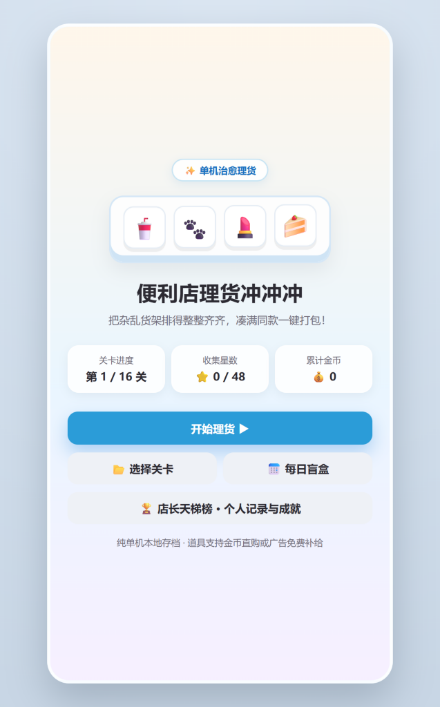
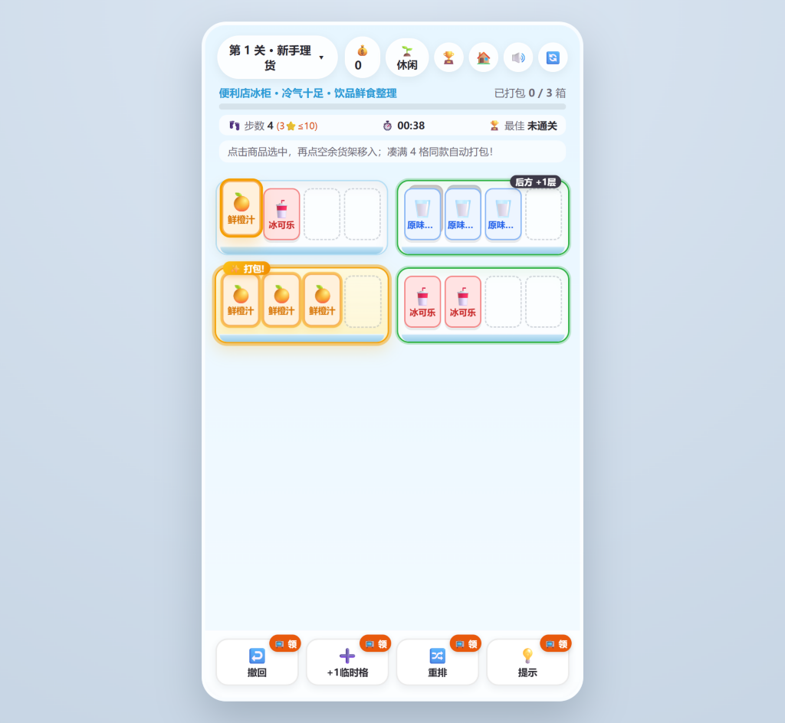
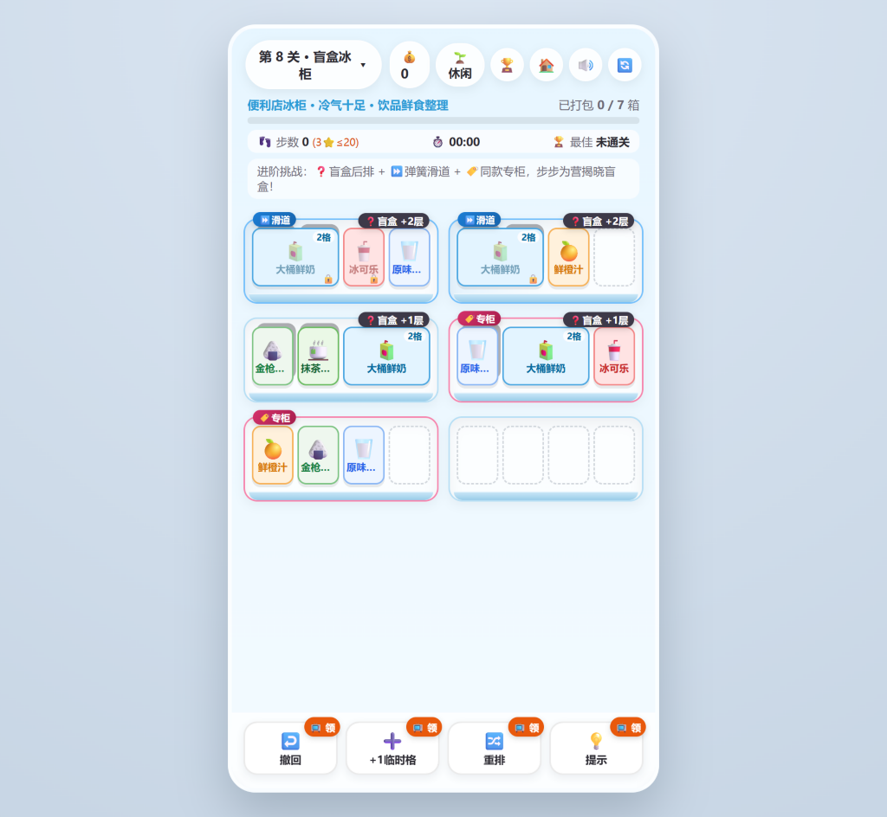
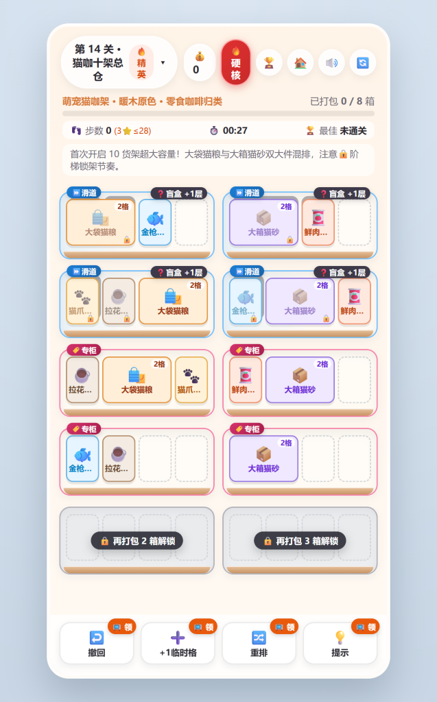

<p align="center">
  
</p>

<h1 align="center">Cozy Shelf Sort — 便利店理货冲冲冲</h1>

<p align="center">
  一款零依赖、开箱即玩的 <strong>2D 立体货架收纳消除</strong> 休闲单机小游戏（原生 HTML5 / CSS3 / JavaScript）。
</p>

<p align="center">
  
  
  
  
  
</p>

<p align="center">
  <strong>中文</strong> | <a href="README.en.md">English</a>
</p>

---

## 游戏简介

把杂乱的多层货架整理得井井有条！在多排纵深货架之间点击或双击搬运商品，前排凑满 **4 格同款商品** 即可触发自动打包收箱，后排暗影商品随之自动前推补位。在有限的货架空间、**2 格异形大件**、**盲盒遮挡**、**弹簧滑道**、**同款专柜** 与 **封条锁架** 之间巧妙腾挪，触发闪送急单与狂热磁铁，冲击最少步数、零道具金冠与「店长天梯榜」榜首。

## 实机画面预览

| 开始界面与生涯统计 | 连携高亮与打包预览（第 1 关） |
| :---: | :---: |
|  |  |
| **滑道 + 专柜 + 盲盒后排（第 8 关）** | **10 货架大型总仓与硬核模式（第 14 关）** |
|  |  |

## 核心爽点与特色

- **爽快即时反馈 + 闪送急单 + 狂热磁铁**：
  - **强化即时封箱视听反馈**：凑满 4 格瞬间触发低频纸箱重击音、升调和弦、冲击波光环与 12 向礼花粒子爆裂，全程零打断、指哪打哪；
  - **闪送急单悬赏**：首箱打包后动态派发限时 `4` 步的外卖急单目标，规定步数内优先打包指定商品立享 **`+25`** 额外金币赏金；
  - **3连击狂热磁铁**：连续 3 次打包触发 `Fever` 状态时自动充能「狂热磁铁」，一键**零步数（0 步）**将全场所有同款商品瞬间吸齐炸箱。
- **爽快连携与一键极速收箱**：移入同款货架或双击商品自动触发**同款批量连携移入**；当所有后排暗影与锁架全揭晓且存在必胜解时，自动浮现 **「一键极速收箱」** 按钮极速清场。
- **倒水级硬核策略机制（滑道单向取物 + 同款专柜禁混放）**：
  - **弹簧滑道货架（LIFO 栈约束）**：复刻《倒水冲冲冲》“不能抽中间”的核心博弈，滑道货架内**仅能拿取最外侧（最右侧）商品**，被挡在内部的商品需先清空外侧方可取出；
  - **同款专柜货架（同色对齐约束）**：专柜货架严禁混放杂物，**仅允许移入与当前柜内最右侧商品同款的商品**（或空柜）；
  - **一键切换全场硬核模式**：顶部状态栏支持随时切换「休闲 / 硬核」，开启硬核模式后全场自动强化滑道与专柜双重约束（全 16 关双模式均通过 `solveLevel` 零道具 100% 可通关校验）。
- **2 格异形大件 + 盲盒与锁架博弈**：引入占 2 格宽度的礼盒/大桶商品、清空前排才揭晓的 **「盲盒后排」** 以及需打包达标自动破封的 **「封条锁架」**。
- **4 大主题 · 16 关单机主线（4~10 货架梯度） · 每日盲盒挑战**：内置「便利店冰柜」「萌宠猫咖架」「治愈梳妆台」「甜品烘焙坊」4 套主题，从新手 4 货架逐步升级至 **8 货架与 10 货架大型仓储关（共 16 关）**，以及按日期种子生成的 **「每日盲盒」**。
- **金币经济与阶梯临时理货台**：底部临时理货台支持逐格扩容（`+1 → +4 格`），赚取的金币可直接购买「撤回 / +1临时格 / 重排 / 提示」4 类道具，或通过 3 秒模拟激励视频免费补给。
- **个人最佳记录（PB）与店长天梯榜**：实时显示步数、三星目标线与计时；自动记录每关**最少步数、最快用时与零道具金冠**，内置 9 段位店长天梯榜与 6 项成就勋章。
- **零依赖纯前端实现**：所有音效均由原生 `Web Audio API` 实时振荡合成，无需外部音频资源，进度自动保存在本地 `localStorage`。

## 快速开始

本项目**零第三方依赖**，无需 `npm install` 或任何构建步骤：

### 1. 启动游戏

- **方式 A（直接打开）**：直接双击打开项目根目录下的 [`index.html`](index.html)。
- **方式 B（本地 HTTP 服务）**：
  ```powershell
  python -m http.server 8080
  ```
  浏览器访问 [http://127.0.0.1:8080](http://127.0.0.1:8080)。

### 2. 操作速查

| 操作 | 说明 |
| --- | --- |
| **单击移动** | 单击前排商品提起，再点目标货架移入（同排多个同款且空位充足时自动**批量连携移入**） |
| **双击快捷移入** | 双击任意前排商品，自动匹配最佳同款货架或空位一键移入 |
| **释放狂热磁铁** | 达成 `×3` 狂热连击后，点击浮现的「狂热磁铁」按钮，0 步吸走全场一整箱同款商品 |
| **切换硬核模式** | 点击顶部导航栏的「休闲 / 硬核」按钮，一键开启「滑道单向取物 + 同款专柜」倒水级难度 |

## 目录结构

```text
cozy-shelf-sort/
├── assets/
│   ├── icons/         # 游戏主图标与备选主题概念图标
│   └── screenshots/   # 实机运行截图（主界面、打包预览、滑道专柜、10货架总仓）
├── index.html         # 游戏主页面（开始界面、局内 HUD、货架舞台与 4 大弹窗）
├── styles.css         # 全局样式表（4 套主题 CSS 变量、立体货架卡片与动效）
├── levels.js          # 4 大主题、26 种商品字典、16 关单机主线（4~10货架）与每日盲盒生成器
├── game.js            # 纯函数核心状态机（移动、滑道、专柜、急单、磁铁、求解器与天梯）
├── app.js             # 视图控制器、Web Audio 实时合成音效与 LocalStorage 存档
└── game.test.js       # Node.js 原生测试套件（19 项核心逻辑与全 16 关双模式可解性测试）
```

## 运行自动化测试

使用 Node.js 18+ 内置测试运行器零配置验证全部 19 项单元测试（包含全部 16 关在休闲与硬核模式下的零道具通关校验）：

```powershell
node --test game.test.js
```
